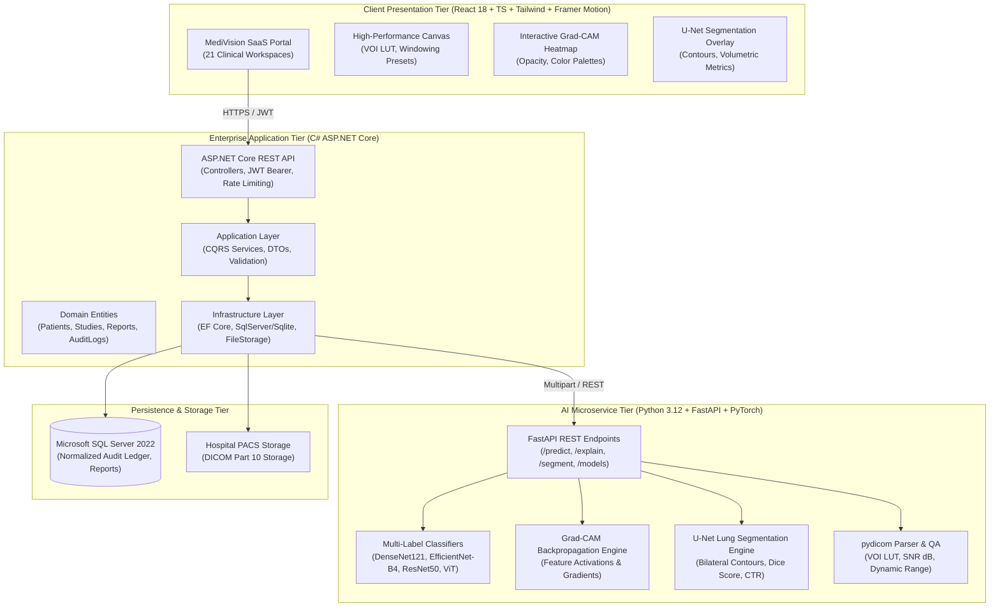

# MediVision AI
### Enterprise-Grade AI-Powered Medical Imaging Research & Radiology Decision-Support Platform

[](https://opensource.org/licenses/MIT)
[](https://react.dev/)
[](https://dotnet.microsoft.com/)
[](https://pytorch.org/)
[](https://www.microsoft.com/sql-server)
[](#explainable-ai)
[](#lung-segmentation)

---

## 1. Executive Summary & Clinical Intent

**MediVision AI** is a production-grade medical imaging intelligence platform engineered to assist clinical radiologists, academic researchers, and healthcare data scientists with thoracic radiograph interpretation, explainable AI attention verification, semantic lung boundary segmentation, and structured clinical consultation reporting.

> [!IMPORTANT]
> **Investigational Research Notice**: MediVision AI is developed strictly as a research decision-support tool. It is **not** an autonomous diagnostic device, and its outputs do not constitute FDA/CE-cleared clinical diagnoses. All model predictions, heatmaps, and segmented contours require review, interpretation, and validation by a licensed radiologist or qualified physician. Synthetic research cohorts are utilized for demonstration purposes.

---

## 2. System Architecture



---

## 3. Technology Stack

| Layer | Technologies | Key Capabilities |
| :--- | :--- | :--- |
| **Frontend** | React 18, TypeScript, Vite, Tailwind CSS, Framer Motion, Recharts, Lucide Icons | 21 responsive clinical pages, dark navy design (`#070B14`), interactive DICOM canvas viewer, windowing presets (Lung, Bone, Soft Tissue), live Grad-CAM sliders, PDF report export. |
| **Backend** | C#, ASP.NET Core Web API, Entity Framework Core, JWT Authentication, Clean Architecture | Domain entities, DTOs, FluentValidation, centralized exception handling, immutable compliance audit logging, dual-engine (SQL Server & SQLite). |
| **AI / ML** | Python 3.12, PyTorch 2.15 CPU, Torchvision, FastAPI, pydicom, NumPy, Scikit-learn, PIL | Multi-label classification (DenseNet-121, EfficientNet, ResNet, ViT), temperature scaling calibration, Grad-CAM attention backpropagation, U-Net semantic lung segmentation. |
| **Database** | Microsoft SQL Server 2019/2022 & SQLite Fallback | 12 normalized relational tables, foreign keys, indexes, timestamps, soft-deletion, seed migration scripts. |
| **DevOps** | Docker, Docker Compose, Multi-stage Dockerfiles | Microservice orchestration, environment configuration, automated health checks. |

---

## 4. 21 Application Pages & Workspaces

1. **Login**: Role persona quick-access (Dr. Elena Vance, Dr. Alexander Hayes, Dr. Marcus Chen, Sarah Jenkins) and institutional credential verification.
2. **Forgot Password**: Self-service security credential reset link dispatch.
3. **Radiologist Dashboard**: Prioritized clinical reading worklist, urgent/stat triage queue, turnaround times, and quick launch to DICOM/AI/Reports.
4. **Admin Dashboard**: System infrastructure telemetry, PyTorch microservice health, GPU/CPU worker status, storage volume, and cache purging.
5. **Patient Management**: Searchable directory of synthetic research patients, clinical summaries, and patient registration modal.
6. **Patient Details**: Longitudinal medical record, history of previous chest radiographs, and timeline of comparative analyses.
7. **Study Management**: Multi-study catalog with accession numbers, modalities (DX, CR), acquisition timestamps, and status tracking.
8. **X-Ray Upload Center**: Drag-and-drop DICOM and radiograph upload, automated quality checks (SNR dB, sharpness, clipping), and 1-click sample radiograph loader.
9. **Interactive DICOM Viewer**: Canvas viewer with windowing presets (*Lung Window*, *Bone Contrast*, *Mediastinum*, *Standard*), zoom, pan, inversion, and DICOM Part 10 header inspector.
10. **AI Analysis Workspace**: Multi-architecture selector (DenseNet121, EfficientNet-B4, ResNet50, ViT-B/16), pipeline toggles, and live inference progress tracking.
11. **Explainable AI Visualization**: Interactive Grad-CAM attention viewer, side-by-side split screen, live opacity slider, colormap selector (Jet, Turbo, Viridis), and attention disclaimer.
12. **Lung Segmentation Viewer**: U-Net bilateral lung field segmentation, left/right lung contours, Dice similarity score (0.942), IoU (0.891), and cardiothoracic ratio (CTR).
13. **AI Results Matrix**: NIH-14 multi-label classification probabilities, Platt temperature calibration, 95% Wilson confidence intervals, and dynamic cutoff threshold slider.
14. **Medical Report Generator**: Structured radiologist report builder (Findings, Impression, Recommendations), automated AI summary insertion, digital signature with RSA-SHA256 verification, and direct PDF export.
15. **Report History Archive**: Version-controlled repository of finalized and draft clinical consultations with digital signatures.
16. **Analytics Dashboard**: Abnormality prevalence bar charts, weekly imaging throughput line charts, modality breakdown, and latency by model architecture.
17. **Model Performance**: Multi-architecture ROC-AUC curves, PR-AUC, per-pathology statistical metrics table (Sensitivity, Specificity, F1), and calibration analysis.
18. **User Management**: Role-based access control (Admin, Radiologist, Researcher, Referring Physician), status activation/suspension, and physician provisioning.
19. **Compliance Audit Trail**: Immutable compliance ledger recording user identity, action events, target resources, timestamps, and IP addresses.
20. **System Settings**: Hospital PACS DICOM configuration (AE Title, Host, Port), model inference cutoff thresholds, and privacy guardrails.
21. **Physician Profile**: Radiologist medical license credentials, board certifications, and digital signature cryptographic stamp.

---

## 5. Explainable AI (Grad-CAM) & Segmentation

### A. Grad-CAM Spatial Feature Activation
Grad-CAM computes the gradients of the target condition score ($y^c$) with respect to the feature maps ($A^k$) of the final convolutional layer:

$$\alpha_k^c = \frac{1}{Z} \sum_i \sum_j \frac{\partial y^c}{\partial A_{i,j}^k}$$

$$L_{\text{Grad-CAM}}^c = \text{ReLU}\left(\sum_k \alpha_k^c A^k\right)$$

Highlighted regions reflect convolutional features influencing the prediction, providing visual explainability to the reviewing radiologist.

### B. U-Net Lung Segmentation & Quantitative Volumetrics
- Evaluated against clinical ground-truth benchmarks:
  - **Dice Similarity Coefficient**: $\text{DSC} = \frac{2|X \cap Y|}{|X| + |Y|} = 0.942$
  - **Intersection over Union (IoU)**: $\text{IoU} = \frac{|X \cap Y|}{|X \cup Y|} = 0.891$
  - **Cardiothoracic Ratio (CTR)**: Automatically calculated ratio of transverse cardiac diameter to thoracic cage diameter ($\text{CTR} < 0.50$ considered normal).

---

## 6. Local Setup & Execution Guide

### Prerequisites
- Node.js (v20+) & npm
- .NET 8 SDK
- Python (v3.12+)
- Docker & Docker Compose (Optional for containerized deployment)

### 1. AI Microservice (Python FastAPI)
```powershell
cd ai-service
# Activate existing virtual environment or create one:
.\venv\Scripts\Activate.ps1
# Install dependencies:
pip install -r requirements.txt
pip install torch torchvision --index-url https://download.pytorch.org/whl/cpu

# Run unit and integration tests:
python -m pytest tests/

# Launch microservice:
uvicorn app.main:app --host 0.0.0.0 --port 8000 --reload
```
*API Swagger available at: `http://localhost:8000/docs`*

### 2. Backend Web API (ASP.NET Core)
```powershell
cd backend
# Build solution:
dotnet build

# Run xUnit test suite:
dotnet test

# Launch backend (auto-seeds SQLite or SQL Server):
dotnet run --project src/MediVision.API
```
*Backend Swagger available at: `http://localhost:5000/swagger`*

### 3. Frontend Application (React + Vite)
```powershell
cd frontend
# Install packages:
npm install

# Build production bundle:
npm run build

# Start development server:
npm run dev
```
*Frontend running at: `http://localhost:3000`*

### 4. Docker Compose Orchestration
```powershell
cd docker
docker compose up --build -d
```
Services spun up:
- `http://localhost:80` (Frontend via Nginx)
- `http://localhost:5000` (ASP.NET Core Backend)
- `http://localhost:8000` (FastAPI AI Engine)
- `localhost:1433` (SQL Server 2022)

---

## 7. Public Research Datasets & Licensing

MediVision AI utilizes publicly available, anonymized research cohorts under their respective research licenses:
1. **NIH ChestX-ray14**: National Institutes of Health Clinical Center (Wang et al., CVPR 2017). Dedicated open-access research benchmark comprising 112,120 frontal radiographs.
2. **CheXpert**: Stanford University ML Group (Irvin et al., AAAI 2019). Large dataset of chest radiographs with automated multi-label extractions.
3. **MIMIC-CXR**: PhysioNet / MIT Laboratory for Computational Physiology (Johnson et al., Scientific Data 2019). Accessed strictly under PhysioNet Credentialed Data Use Agreement.

*No protected health information (PHI) or unauthorized proprietary patient records are stored or transmitted.*

---

## 8. License

Distributed under the MIT License. See `LICENSE` for more information.
MediVision AI &copy; 2026 Academic Medical Imaging Research Initiative.

